<samp>rocco panizzi · MSc in computer science & engineering @ polimi</samp>

Lately I've been working on [Z-Ant](https://github.com/rocco822/Z-Ant), which runs neural networks on microcontrollers. Before that, [Mesos](https://github.com/rocco822/mesos-board-game): an online multiplayer board game, my Software Engineering final project.

<picture>
  <source media="(prefers-color-scheme: dark)" srcset="assets/music-dark.svg">
  
</picture>

<picture>
  <source media="(prefers-color-scheme: dark)" srcset="assets/films-dark.svg">
  
</picture>

<samp><a href="https://www.linkedin.com/in/rocco-panizzi-0550b42a3/">linkedin</a> · <a href="mailto:rocco.panizzi@gmail.com">email</a></samp>
